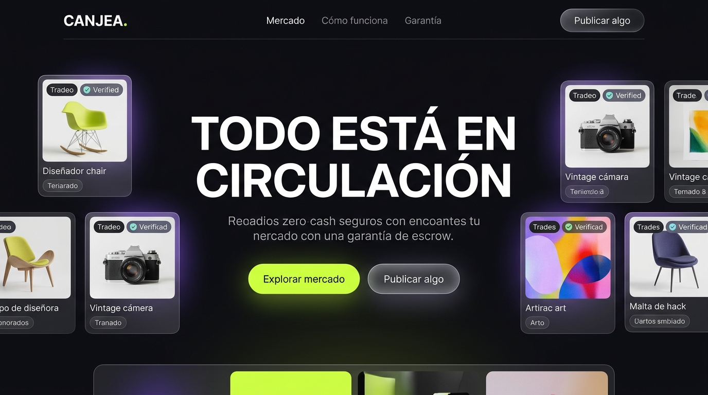

# CANJEA

Mercado abierto de intercambio multilateral: plataforma para la publicacion de ofertas y necesidades, negociacion de trueques directos y canjes mixtos con liquidacion monetaria respaldada por cuenta de garantia (escrow).

---

## Capturas de la Plataforma

### Vista Principal e Identidad Visual


### Mercado y Diseno Responsivo Multi-Dispositivo


---

## Arquitectura del Sistema

CANJEA esta implementado como un monorepositorio estructurado con separacion estricta entre la capa de interfaz de usuario, los servicios de backend y el motor de almacenamiento relacional:

```
canjea/
├── apps/
│   ├── api/                     # Backend: Express 5, TypeScript, PostgreSQL
│   │   ├── src/
│   │   │   ├── config/          # Validacion estricta de variables de entorno (Zod)
│   │   │   ├── db/              # Esquema DDL PostgreSQL, migraciones y siembra
│   │   │   ├── lib/             # Conexion a PG (Pool), tokens, RBAC, auditoria
│   │   │   ├── middleware/      # Rate limits, autenticacion, manejo global de errores
│   │   │   └── modules/         # Modulos de negocio: auth, listings, deals, wallet, etc.
│   │   └── Dockerfile           # Compilacion multi-stage e imagen de produccion Node.js
│   └── web/                     # Frontend: Angular 22 (Standalone, Signals, Zoneless)
│       ├── src/app/
│       │   ├── core/            # Servicios HTTP, interceptores, guards de navegacion
│       │   ├── features/        # Modulos de interfaz: landing, market, deals, admin, auth
│       │   ├── layout/          # Estructura del shell, navegacion lateral y barra movil
│       │   └── shared/          # Componentes reutilizables, UI, iconos vectoriales
│       ├── nginx.conf           # Configuracion de Nginx como proxy inverso y servidor estatico
│       └── Dockerfile           # Compilacion de Angular y despliegue sobre Nginx Alpine
├── docs/
│   └── screenshots/             # Capturas de pantalla y material documental de la plataforma
├── docker-compose.yml           # Orquestacion de PostgreSQL 16, API REST y Frontend Web
├── package.json                 # Scripts de orquestacion para desarrollo y construccion local
└── README.md                    # Documentacion general del proyecto
```

---

## Pila Tecnologica

| Componente | Tecnologia | Descripcion Tecnica |
| :--- | :--- | :--- |
| Frontend | Angular 22 | Arquitectura basada en Standalone Components, Signals de estado reactivo, modo Zoneless y estilos SCSS modulares. |
| Backend | Express 5 / TypeScript | API REST con validacion de esquemas en tiempo de ejecucion mediante Zod, tipado estricto y ejecucion asincrona modular. |
| Base de Datos | PostgreSQL 16 | Almacenamiento relacional transaccional (ACID) con soporte de `SAVEPOINT` para transacciones compuestas complejas. |
| Servidor Web | Nginx Alpine | Servidor web de alto rendimiento para el empaquetado del cliente web y proxy inverso hacia el backend `/api/`. |
| PWA | Angular Service Worker | Registro de Service Worker, cache de manifiestos, instalabilidad nativa y funcionamiento fuera de linea para activos estaticos. |
| Seguridad | scrypt / JWT / Helmet | Derivacion de claves via scrypt con sal criptografica, tokens de acceso efimeros y rotacion de refresh tokens httpOnly. |

---

## Modelo de Base de Datos (PostgreSQL)

La base de datos relacional esta estructurada bajo PostgreSQL 16 garantizando integridad referencial y restricciones CHECK a nivel de motor:

- **`users`**: Registra credenciales hash, perfil publico, roles (`USER`, `MODERATOR`, `ADMIN`), estado de cuenta (`ACTIVE`, `SUSPENDED`, `DELETED`), calificacion promedio y version de token para invalidacion de sesiones.
- **`categories`**: Catalogo base indexado para clasificar publicaciones (Tecnologia, Hogar, Bicicletas, Musica, Diseno, Servicios, Comida, Libros, Gaming, Moda).
- **`listings`**: Publicaciones del mercado de tipo oferta (`OFFER`) o necesidad (`NEED`), con modalidad de intercambio (`BARTER`, `CASH`, `BOTH`), precio en centavos, condiciones de producto y etiquetas.
- **`deals`**: Negociaciones de trueque y compraventa. Vincula al dueno y al proponente, item ofrecido a cambio y montos de garantia retenidos en custodia.
- **`wallets`**: Billetera por usuario con saldo disponible (`balance_cents`) y fondos retenidos en garantia (`escrow_cents`).
- **`transactions`**: Libro contable de movimientos (recargas, retenciones en garantia, liberaciones, devoluciones y cobro de comisiones).
- **`reviews`**: Evaluaciones bidireccionales con calificacion del 1 al 5 y comentarios tras finalizar un canje.
- **`notifications`**: Sistema de avisos internos con estado de lectura y marcas de tiempo.
- **`audit_logs`**: Registro inmutable de trazabilidad de acciones operativas y administrativas.
- **`verification_codes`**: Codigos criptograficos con expiracion para verificacion de correo y recuperacion de acceso.
- **`refresh_tokens`**: Registro de tokens de sesion activos con asociacion de agente de usuario e IP.

---

## Despliegue con Docker

El proyecto se encuentra totalmente contenedorizado para permitir despliegues inmediatos e identicos entre entornos.

### Requisitos Previos
- Docker Engine 24+
- Docker Compose v2+

### Puesta en Marcha con Docker Compose

Para compilar y levantar la totalidad de los servicios en segundo plano:

```bash
docker compose up -d --build
```

El orquestador ejecutara los siguientes contenedores interconectados mediante una red privada interna (`canjea_net`):
1. **`canjea_db`**: Instancia de PostgreSQL 16 con volumen persistente (`canjea_pgdata`) y verificador de salud (`pg_isready`). Expuesto en el puerto host `5433` (interno `5432`).
2. **`canjea_api`**: Servicio backend Node.js en modo produccion. Espera a que PostgreSQL este en estado `healthy`, ejecuta de forma automatica la migracion de esquema relacional y la siembra del usuario administrador. Expuesto en el puerto host `4100`.
3. **`canjea_web`**: Servidor Nginx que entrega los artefactos estaticos de Angular optimizados y gestiona el proxy inverso hacia el backend en `/api/`. Expuesto en el puerto host `4200`.

### Verificacion de Estado

```bash
# Inspeccionar contenedores en ejecucion
docker compose ps

# Visualizar registros consolidados
docker compose logs -f api

# Detener los servicios
docker compose down
```

---

## Cuenta de Administracion Inicial

La base de datos se inicializa con un unico usuario con privilegios totales de administracion (ADMIN), eliminando cualquier usuario o publicacion de prueba:

- **Correo electronico:** `ivanjmm01@gmail.com`
- **Contrasena de acceso:** `322-520iM.`
- **Rol:** `ADMIN`
- **Permisos:** Administracion total de usuarios, roles, publicaciones, auditoria, revision de transacciones y gestion de plataforma.

---

## Flujo Operativo: Trueque y Garantia de Pago (Escrow)

CANJEA implementa un modelo de intercambio hibrido disenado para eliminar el riesgo de fraude en transacciones entre particulares:

```
[ Usuario A ]                        [ Sistema Escrow ]                       [ Usuario B ]
      |                                      |                                      |
      | ---- Propone trueque / fondos -----> |                                      |
      |                                      | ---- Notifica propuesta -----------> |
      |                                      |                                      |
      |                                      | <--- Acepta trato ------------------ |
      |                                      |                                      |
      | [ Fondos retenidos en garantia ] --- |                                      |
      |                                      |                                      |
      | <============ Intercambio fisico o entrega de bienes ============> |
      |                                      |                                      |
      | ---- Confirma recepcion -----------> |                                      |
      |                                      | ---- Libera fondos (-5% fee) ------> |
      |                                      |                                      |
```

1. **Propuesta:** El usuario proponente selecciona un producto, define si ofrecera otro articulo a cambio, dinero real o una combinacion de ambos.
2. **Retencion:** Al ser aceptada la propuesta por el propietario, los fondos monetarios estipulados se retienen en garantia dentro de la billetera del proponente (`escrow_cents`), inmovilizando los recursos para asegurar el cumplimiento.
3. **Liberacion:** Al concluir satisfactoriamente el intercambio fisico o de servicios, la garantia se transfiere a la billetera disponible del propietario, deduciendo la comision operativa estipulada de la plataforma (5%).
4. **Cancelacion o Disputa:** En caso de no concretarse la operacion, los fondos son reintegrados integramente al proponente de forma automatica.

---

## Especificacion de Diseno Responsivo

La interfaz de usuario ha sido disenada para ofrecer una experiencia fluida y consistente a traves de 5 rangos de resolucion de pantalla:

| Categoria de Pantalla | Rango de Resolucion | Comportamiento y Adaptacion de Interfaz |
| :--- | :--- | :--- |
| Pantallas Super Amplias y 4K | >= 1800px hasta 2560px+ | Cuadricula del mercado expandida a 5 y 6 columnas; contenedores de ancho fluido hasta 2180px; navegacion ampliada y proporciones tipograficas escaladas para monitores de alta densidad visual. |
| Monitores y Pantallas Amplias | 1440px a 1799px | Cuadricula de 4 columnas en catalogo; dashboard administrativo con distribucion balanceada a 3 columnas; contenedor restringido a 1380px para lectura ergonomica. |
| Laptops y Pantallas Estandar | 1024px a 1439px | Disposicion de escritorio estandar: barra lateral de navegacion fija (262px), catalogo en 3 columnas y encabezado con acceso directo a busqueda global. |
| Tablets (Horizontal y Vertical) | 681px a 1023px | Barra lateral replegable mediante boton de acceso rapido y mascara oscura; cuadricula de productos adaptada a 2 columnas; tablas de datos con desplazamiento horizontal suave (`touch-scroll`). |
| Celulares y Moviles Compactos | 320px a 680px | Navegacion inferior fija (`bottom-nav`) con soporte de zonas seguras (`safe-area-inset-bottom`); filtros y formularios reorganizados en columna unica vertical; botones tactiles optimizados con altura minima de 44px. |

---

## Referencia de Endpoints del API

Base URL local: `http://localhost:4100/api` (o via proxy `http://localhost:4200/api`)

### Autenticacion y Sesion
- `POST /auth/register` - Registro de nueva cuenta de usuario.
- `POST /auth/login` - Inicio de sesion y emision de cookie `httpOnly` para refresh token.
- `POST /auth/refresh` - Renovacion rotativa de token de acceso JWT.
- `POST /auth/logout` - Revocacion de la sesion actual.
- `GET  /auth/me` - Perfil autenticado, roles, permisos y resumen de billetera.
- `POST /auth/verify-email` - Validacion de direccion de correo mediante codigo temporal.
- `POST /auth/change-password` - Cambio de contrasena e invalidacion de sesiones activas.

### Mercado y Publicaciones
- `GET    /listings` - Consulta paginada con filtros por categoria, modalidad, rango de precio y ubicacion.
- `GET    /listings/:id` - Detalle completo de publicacion y sugerencias relacionadas.
- `POST   /listings` - Creacion de nueva oferta o necesidad (requiere correo verificado).
- `PATCH  /listings/:id` - Modificacion de publicacion propia.
- `DELETE /listings/:id` - Baja logica de publicacion.
- `POST   /listings/:id/favorite` - Registro o eliminacion de elemento en favoritos.

### Negociaciones y Garantia (Deals)
- `GET   /deals` - Listado de tratos entrantes y salientes del usuario autenticado.
- `POST  /deals` - Envio de propuesta formal de canje con fondos en garantia opcionales.
- `GET   /deals/:id` - Detalle de negociacion con estado y acciones disponibles.
- `PATCH /deals/:id/respond` - Aceptacion o rechazo formal de propuesta recibida.
- `PATCH /deals/:id/complete` - Cierre del trato y liberacion de fondos de garantia.
- `PATCH /deals/:id/cancel` - Cancelacion de la negociacion y reembolso de fondos.
- `POST  /deals/:id/review` - Emision de calificacion y resena tras canje concretado.

### Billetera y Movimientos
- `GET  /wallet` - Saldo liquido disponible, montos en garantia e historial de transacciones.
- `POST /wallet/topup` - Simulacion de abono de fondos a la cuenta.
- `POST /wallet/withdraw` - Solicitud de retiro de saldo disponible.

### Administracion y Auditoria
- `GET   /admin/stats` - Metricas globales de usuarios, volumen de canjes y transacciones.
- `GET   /admin/audit` - Registro inmutable de eventos del sistema e intervenciones de moderacion.
- `GET   /users` - Gestion administrativa de usuarios con busqueda y filtrado por estado.
- `PATCH /users/:id/role` - Modificacion de rol de usuario (`USER`, `MODERATOR`, `ADMIN`).
- `PATCH /users/:id/status` - Suspension o reactivacion de cuentas.

---

## Desarrollo Local sin Contenedores

Si desea ejecutar el entorno localmente fuera de Docker:

```bash
# 1. Instalar dependencias en todos los paquetes
npm run install:all

# 2. Configurar variables de entorno
cp apps/api/.env.example apps/api/.env

# 3. Levantar la base de datos PostgreSQL y aplicar esquema inicial
npm run seed

# 4. Iniciar servidores de desarrollo concurrentes
npm run dev:api     # Backend en http://localhost:4100
npm run dev:web     # Frontend en http://localhost:4200
```

---

## Licencia

CANJEA es software privado desarrollado para transacciones seguras de intercambio multilateral. Todos los derechos reservados.
